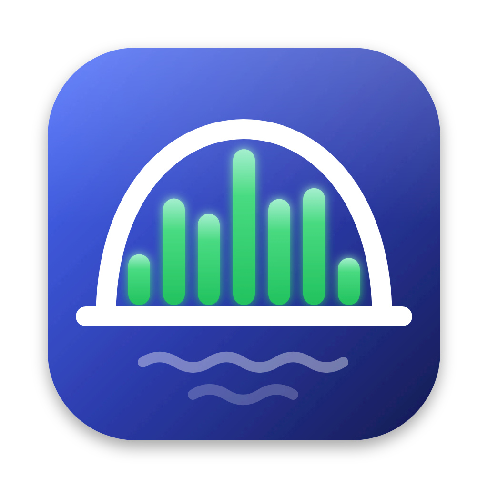
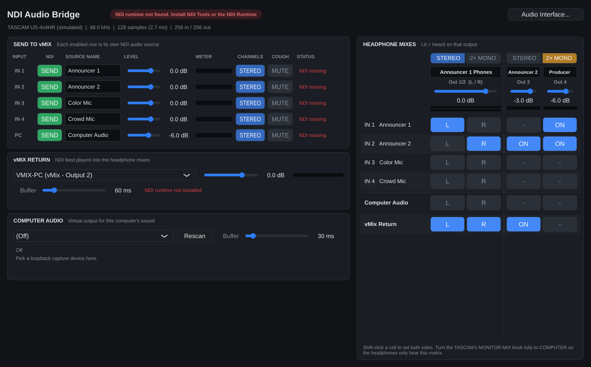

# NDI Audio Bridge

Send the inputs of an audio interface (e.g. a TASCAM US-4x4HR) to vMix as separate
NDI audio sources, bring an NDI return feed back from vMix, and build per-announcer
headphone mixes on the interface outputs with a simple on/off matrix. Includes a
virtual audio output so the computer's own sound can go through it too.

Runs on **macOS** (11+, Apple Silicon and Intel) and **Windows** (10/11, x64).



```
 TASCAM IN 1-4 ──┬──────────────► NDI sources "Announcer 1", "Announcer 2", ... ──► vMix
                 │
 Computer audio ─┼──────────────► NDI source  "Computer Audio" ───────────────────► vMix
 (virtual output)│
                 ▼
 vMix NDI out ──► HEADPHONE MATRIX ──► TASCAM outputs: per channel, as stereo pairs
                  (toggle what each        or as separate mono feeds
                   output hears)
```

## What it does

| Panel | What it's for |
|---|---|
| **Send to vMix** | One row per interface input. **SEND** publishes it as its own NDI source, named whatever you type. Level, meter, **STEREO/MONO** (mic inputs go out dual-mono in stereo mode, which vMix handles best), and a **MUTE** cough button that silences the send to vMix without touching the headphones. The last row is the computer audio. |
| **vMix return** | Pick any NDI source on the network (e.g. a vMix output). Only its audio is received. A small buffer absorbs network jitter, and the app continuously corrects clock drift between the vMix machine and the interface, so it never clicks or drifts out of sync. |
| **Computer audio** | Pick the virtual device your computer plays into. It can be sent as its own NDI source and/or put into the headphone mixes. |
| **Headphone mixes** | Each output pair (Out 1/2, Out 3/4, ...) is either **STEREO** (one mix, one name and level) or **2× MONO** (each output is its own mix with its own name, level and meter, e.g. two separate headphone feeds). Every cell routes a source to one output channel, so left and right are always set separately: put a mic in one ear only, or build a split feed. Stereo sources (vMix return, computer audio) keep their L/R in a stereo pair and fold to mono in 2× mono. Shift-click a cell to set both sides at once. |

Everything you change is saved automatically and restored the next time you open the app.

> **TASCAM tip:** turn the interface's **MONITOR MIX** knob fully to **COMPUTER**. Otherwise the
> hardware also sends every input straight to the headphones and the matrix can't turn them off.

---

## Setup: macOS

1. **Install the NDI Runtime** (free): <https://ndi.link/NDIRedistV6Apple>. It installs
   `libndi.dylib`, which the app loads. NDI Tools (<https://ndi.video/tools/>) is worth having too
   (NDI Access Manager, Studio Monitor), but the app needs the runtime itself.
2. **Install the app.** Unzip `NDI-Audio-Bridge-macOS.zip`. These builds aren't notarized by
   Apple, so clear the download flag on the whole folder once in Terminal (adjust the path if you
   unzipped somewhere else):
   ```bash
   xattr -dr com.apple.quarantine ~/Downloads/"NDI Audio Bridge"
   ```
   Then drag **NDI Audio Bridge.app** to Applications.
3. **Install the virtual output.** In the unzipped folder, double-click
   **Install Virtual Audio Device.command** and enter your password when asked. This adds a
   sound device called **NDI Audio Bridge**.
4. **System Settings > Sound > Output**: choose **NDI Audio Bridge**. Everything the Mac
   plays now goes into the app.
5. Open **NDI Audio Bridge** and allow **Microphone** (needed to read the interface inputs) and
   **Local Network** (needed for NDI) when macOS asks.
6. Click **Audio Interface...** and choose the TASCAM for both input and output, **48000 Hz**,
   buffer **128** (raise it to 256 if you hear crackles). The app picks the TASCAM
   automatically on first launch if it's plugged in.
7. In **Computer Audio**, choose **NDI Audio Bridge**.

To remove the virtual device later, run the installer with `--uninstall` in Terminal:

```bash
bash ~/Downloads/"NDI Audio Bridge"/"Install Virtual Audio Device.command" --uninstall
```

If you'd rather use stock BlackHole, `brew install blackhole-2ch` and pick
**BlackHole 2ch** in steps 4 and 7 instead.

## Setup: Windows

1. **Install NDI Tools** (free) from <https://ndi.video/tools/>. It includes the NDI runtime
   (or install just the runtime: <https://ndi.link/NDIRedistV6>).
2. **Install the TASCAM driver** (it includes the ASIO driver).
3. **Install VB-Audio Virtual Cable** (free) from <https://vb-audio.com/Cable/>. That's
   Windows' equivalent of the virtual output. Then right-click the speaker icon > **Sound
   settings** and set the output device to **CABLE Input**.
4. Unzip `NDI-Audio-Bridge-Windows.zip` and run **NDI Audio Bridge.exe**. When Windows Firewall
   asks, allow it on **Private networks** (NDI won't work otherwise).
5. **Audio Interface...**: set the type to **ASIO** and choose the TASCAM, 48000 Hz, buffer 128.
   Use ASIO: in "Windows Audio" mode the TASCAM's inputs may appear as separate stereo devices.
6. In **Computer Audio**, choose **CABLE Output**.

## Setup: vMix

**Getting the announcers into vMix:** *Add Input > NDI / Desktop Capture* and pick
`YOUR-MAC (Announcer 1)`, `YOUR-MAC (Announcer 2)`, and so on. Each one is a separate vMix input
with its own fader. Add `YOUR-MAC (Computer Audio)` the same way if you send it.

**Sending a return feed back:** in vMix, enable NDI on one of the outputs (*Settings > Outputs /
NDI / SRT*) and set that output's audio to the mix the announcers should hear. Then select
it in the app's **vMix Return** list (names look like `VMIX-PC (vMix - Output 2)`).

> **Use a mix-minus for the return.** If the return feed contains the announcers' own mics,
> they'll hear themselves twice: once instantly through the matrix, then again delayed through
> vMix. Point the return at a vMix bus (e.g. Bus A) that carries program audio *without* the
> announcer mics, and let the headphone matrix handle hearing themselves and each other.

---

## Latency

* Interface buffer 128 samples @ 48 kHz ≈ 2.7 ms. The headphone matrix runs at this latency,
  so announcers hear themselves and each other almost instantly.
* NDI sends go out in 10 ms frames; vMix adds its own buffering on top.
* The return **Buffer** (default 60 ms) covers network jitter. On a solid wired network
  you can lower it to ~30 ms. If the status line shows the *dropouts* count going up, raise it.
  The status line also shows the live buffer and the drift correction in ppm.

## Troubleshooting

| Symptom | Fix |
|---|---|
| Red "NDI runtime not found" | Install the NDI Runtime (links in the setup steps above), restart the app. To point at a specific library, set `NDI_AUDIO_BRIDGE_NDI_LIB=/path/to/libndi.dylib`. |
| vMix doesn't list the sources | Same network/subnet? Windows Firewall allowed on Private networks? On macOS, Local Network permission (System Settings > Privacy & Security > Local Network). Across subnets, add the vMix PC's IP with **NDI Access Manager** (part of NDI Tools) on both machines. |
| Status says "Live, 0 receivers" | The source is on the network, but vMix hasn't added it as an input yet. |
| Meters move but no sound from vMix | Check the row isn't on **MUTE** and the input is unmuted in vMix. |
| Everyone hears every mic regardless of the matrix | Turn the TASCAM's MONITOR MIX knob fully to COMPUTER. |
| No input level at all on macOS | System Settings > Privacy & Security > Microphone: enable NDI Audio Bridge. |
| Computer audio silent | System (or Windows) output must be set to the virtual device, and the same device picked in **Computer Audio**. |
| Return crackles or drops out | Raise the return **Buffer**, use wired Ethernet rather than Wi-Fi. |

---

## Building from source

Requirements: CMake 3.22+, a C++17 compiler (Xcode on macOS, Visual Studio 2022 on Windows),
git. JUCE is downloaded automatically. The NDI headers (MIT-licensed) are included in
`third_party/ndi`. The NDI library itself is loaded at runtime, so the NDI SDK isn't needed.

```bash
cmake -B build -DCMAKE_BUILD_TYPE=Release
```

```bash
cmake --build build --config Release --target NDIAudioBridge
```

The app lands in `build/NDIAudioBridge_artefacts/Release/`. For a universal macOS build add
`-DCMAKE_OSX_ARCHITECTURES="arm64;x86_64"` to the first command.

The virtual device for macOS (needs Xcode):

```bash
scripts/macos/build-virtual-device.sh
```

```bash
scripts/macos/install-virtual-device.sh build-virtual-device/NDIAudioBridge.driver
```

**Prebuilt downloads** are on the [Releases page](../../releases). The workflow in
`.github/workflows/build.yml` builds the macOS zip (app + virtual device) and the Windows zip on
every push (downloadable from the run's *Artifacts*). To publish a new release, bump the version
in `CMakeLists.txt` (`project(NDIAudioBridge VERSION 0.1.1 ...)`) and push to `main`. The
workflow creates the `v0.1.1` tag and release with both zips. Pushing a `v*` tag works too.

### Self-test

`NDIAudioBridgeSelfTest` runs without audio hardware. It simulates 10 minutes of a bursty,
drifting network feed (±300 ppm, 25/30 fps frame sizes, 48 kHz → 44.1 kHz) and checks for
zero dropouts, steady latency and a click-free signal. If an NDI runtime is installed, it also
sends a tone through a real NDI sender and receiver and checks it arrives intact.

### Code layout

```
src/engine/AudioEngine.*   device callbacks, routing matrix, NDI wiring
src/engine/Settings.*      save/restore
src/dsp/DriftFifo.h        clock-drift-correcting resampling FIFO (return + computer audio)
src/dsp/StereoFifo.h       lock-free FIFO between audio callback and NDI thread
src/ndi/                   runtime NDI loader, sender hub, receiver, source finder
src/ui/MainComponent.*     the window
scripts/macos/             virtual audio device build/install
```

## Licenses

* This project's own source code is MIT-licensed (see [LICENSE](LICENSE)).
* It's built with JUCE, which is used under its open-source license (AGPLv3). So the compiled
  app as a whole falls under AGPLv3 unless you have a commercial JUCE license. For personal or
  in-house use this changes nothing; it only matters if you distribute the app.
* NDI headers in `third_party/ndi` are MIT-licensed. The NDI runtime is installed separately
  and covered by the NDI license. NDI® is a registered trademark of Vizrt NDI AB.
* The macOS virtual device is built from [BlackHole](https://github.com/ExistentialAudio/BlackHole)
  (GPL-3.0).
